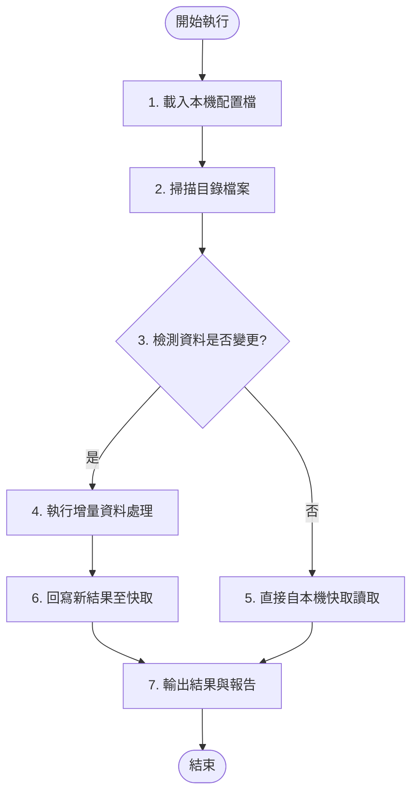
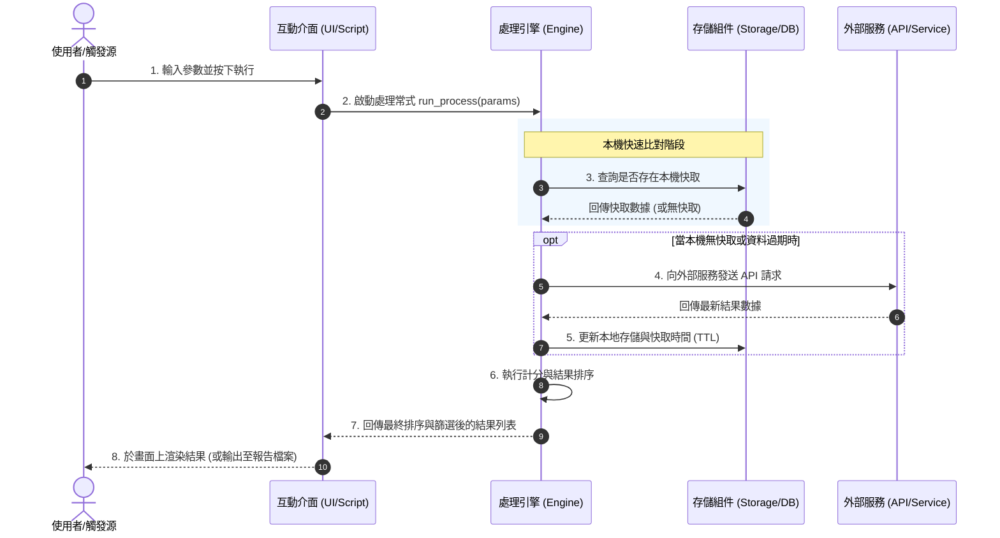

# 系統流程與時序圖模板 (Diagrams)

本文件使用圖表詳細描繪系統的動態執行流程、資料流向以及各組件之間的時序互動關係。

---

## 1. 核心業務執行流程圖 (Process Flowchart)

> [說明：使用 Mermaid `graph` 流程圖展示業務運作或資料處理的各個階段與分支判定]

---

## 2. 跨組件時序互動圖 (Sequence Diagram)

> [說明：使用 Mermaid `sequenceDiagram` 展示當使用者或排程觸發特定事件時，多個組件/角色之間的動態呼叫關係]

