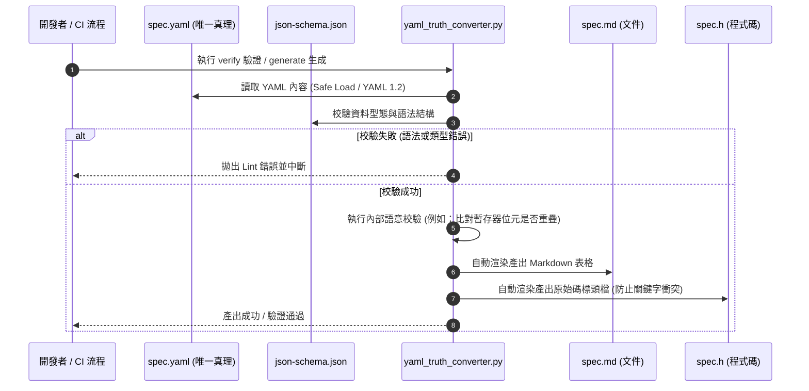
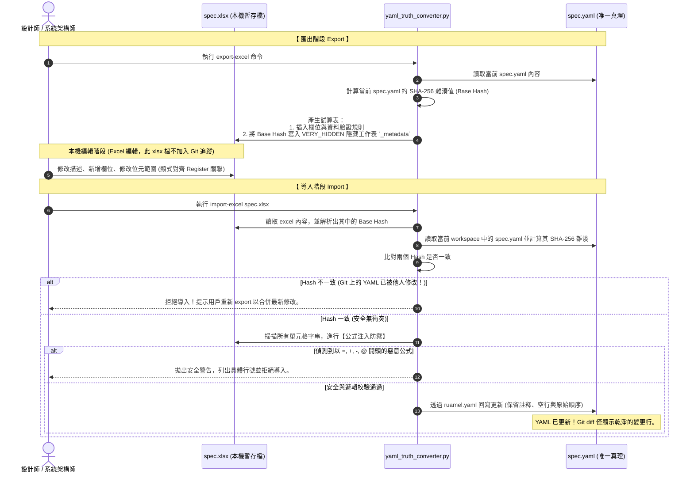

# YAML 唯一真理來源 (Single Source of Truth) 架構與轉換規格範本

本文件定義並規範了專案中「**將 YAML 作為唯一真理來源 (YAML as SSoT)**」的設計架構。此模式特別適用於包含大量結構化中介資料 (Metadata) 的專案（例如：暫存器定義地圖、通訊協定封包格式、系統暫存配置、靜態路由定義等），確保人類閱讀的規格文件、編譯器使用的程式碼，以及自動化測試腳本永遠保持一致，徹底解決「文件與代碼不同步 (Split-Brain)」的痛點。

---

## 💡 設計哲學 (Design Philosophy)

在傳統開發流程中，規格資料往往被重覆手動維護於多處：
* **人類工程師與 PM** 習慣在 Excel 或 Word 撰寫規格書。
* **韌體/軟體工程師** 手動將規格翻譯成 C 頭文件 (`.h`)、Python 類別或 JSON 格式。
* **測試團隊** 再次手動將其編寫為測試腳本。

這導致每次修改規格都需要在多個地方重做，極易遺漏並產生缺陷。

**YAML 作為唯一真理來源** 的核心理念是：**僅允許在 `spec.yaml` 中對結構化資料進行手動修改。所有衍生產出（包括 Excel 編輯檔、Markdown 文件、以及各語言原始碼）皆由自動化腳本 downstream 生成。**

```mermaid
graph TD
    YAML["spec.yaml (唯一真理來源 SSoT)"]
    Schema["json-schema.json (語法與結構驗證)"]
    PythonTool["yaml_truth_converter.py (Parser / Converter / Generator)"]
    
    Excel["spec.xlsx (本機編輯 Excel - 忽略 Git)"]
    MD["spec.md (專案 Markdown 文件)"]
    PyClass["spec.py (Python 資料類別)"]
    CHeader["spec.h (C 語言常數與巨集)"]

    YAML -->|1. 結構校驗| Schema
    YAML -->|2. 輸入源| PythonTool
    PythonTool -->|3. 自動生成| MD
    PythonTool -->|3. 自動生成| PyClass
    PythonTool -->|3. 自動生成| CHeader

    %% 雙向同步機制
    PythonTool -.->|匯出與雜湊鎖定| Excel
    Excel -.->|修改後導入| PythonTool
    PythonTool -.->|保留註釋回寫 (ruamel.yaml)| YAML
```

---

## 🔄 雙向轉換管線 (Bi-directional Pipeline)

為同時兼顧「非工程人員在 Excel 中的批量編輯便利性」與「軟體建構流程 (CI/CD) 的自動化要求」，系統實作了**雜湊鎖定 (Fingerprint Lock)** 的雙向轉換流程。

### 1. 正向生成與驗證流程 (Forward Generation & CI)
在 CI/CD 中，或每次提交 (Commit) 代碼前，工具鏈會驗證真理源與產出物是否一致：



### 2. 雙向 Excel 同步與雜湊鎖定流程 (Bidirectional Sync with Fingerprint Lock)
為了避免多人協作時，舊版的 Excel 覆蓋了 Git 倉庫中最新的 YAML 改動，我們在 Excel 中引入了 `SHA-256` 隱式雜湊鎖定：



---

## 🗂️ 資料結構設計與 Excel 關係對齊

為了保證 Excel 在進行「重新排序 (Sort)」或「新增空行」時不會損毀層級結構（例如 Register 與 Field 的 1:N 巢狀關係），我們拋棄了合併儲存格的隱式關聯，採用**顯式外鍵對齊 (Explicit Relational Mapping)**。

### 1. YAML 真理源資料範例 (`spec.yaml`)
YAML 中保持天然的巢狀結構，利於代碼生成：
```yaml
# cspell:disable
version: "1.2.0"
metadata:
  title: "環境感測器暫存器地圖規格書"
  description: "定義感測節點的 I2C 暫存器與資料欄位對齊規範"

registers:
  - address: "0x00"
    name: "SYS_STATUS"
    access: "RO"
    description: "系統狀態與健康指標暫存器"
    fields:
      - bit_range: [0, 0]
        name: "ALIVE"
        type: "boolean"
        description: "系統運行指示位元。1 代表運作正常。"
      - bit_range: [1, 3]
        name: "ERROR_CODE"
        type: "enum"
        description: "錯誤分類: 0=正常, 1=I2C失敗, 2=低電壓警告"

  - address: "0x04"
    name: "ENV_TEMP"
    access: "RO"
    description: "環境溫度數值暫存器"
    fields:
      - bit_range: [0, 15]
        name: "RAW_ADC"
        type: "uint"
        description: "未校正的 ADC 原始溫度數值"
```

### 2. 扁平化 Excel 表格映射 (Fields Sheet)
當轉換工具導出成 Excel 時，會將資料扁平化為二維表格，並在 Field 中**顯式加入「Parent Register」欄位**：

| Parent Register (外鍵鎖定) | Field Name | Bit Start | Bit End | Type | Description |
| :--- | :--- | :---: | :---: | :--- | :--- |
| `SYS_STATUS` | `ALIVE` | 0 | 0 | `boolean` | 系統運行指示位元。1 代表運作正常。 |
| `SYS_STATUS` | `ERROR_CODE` | 1 | 3 | `enum` | 錯誤分類: 0=正常, 1=I2C失敗, 2=低電壓警告 |
| `ENV_TEMP` | `RAW_ADC` | 0 | 15 | `uint` | 未校正的 ADC 原始溫度數值 |

*註：即使非工程人員在 Excel 中對欄位名稱進行 A-Z 排序，導入腳本依然能透過「Parent Register」欄位精確還原 1:N 巢狀樹狀結構。*

---

## 🛠️ Python 轉換腳本架構設計

為使程式碼與邏輯完全解耦，轉換腳本 `scripts/yaml_truth_converter.py` 採用經典的 **三層架構**：

```mermaid
graph TD
    InYAML["spec.yaml"] -->|1. ruamel.yaml| ParserLayer
    InExcel["spec.xlsx"] -->|1. openpyxl| ParserLayer
    
    subgraph 轉換引擎 (Converter Engine)
        ParserLayer["解析層 (Parser Layer)<br/>- 負責實體檔案讀取<br/>- 使用 JSON Schema 進行基本類型校驗"]
        AST["內部物件模型 (AST / Objects)<br/>- RegisterMap, Register, Field 類別物件"]
        ValidatorLayer["驗證層 (Validator Layer)<br/>- 檢查重疊位元<br/>- 位址對齊校驗<br/>- 代碼關鍵字黑名單檢查"]
        GeneratorLayer["生成層 (Generator Layer)<br/>- markdown 渲染<br/>- C/Python 原始碼生成<br/>- ruamel.yaml 註釋保留寫入"]
        
        ParserLayer -->|反序列化| AST
        AST -->|語意規則檢查| ValidatorLayer
        ValidatorLayer -->|資料驅動生成| GeneratorLayer
    end

    GeneratorLayer -->|輸出| OutMD["spec.md (文件)"]
    GeneratorLayer -->|輸出| OutCode["spec.h / spec.py (代碼)"]
    GeneratorLayer -->|輸出| OutExcel["spec.xlsx (Excel 表格)"]
```

### 1. 解析層 (Parser Layer)
* 讀取 YAML 時必須指定 YAML 1.2 版本，並使用 `ruamel.yaml.YAML(typ='rt')`（Round-Trip 模式）。這可確保寫回時**不會遺失開發者手動撰寫的註釋 (# comments) 與縮排空白**，大幅降低 Git commit 衝突機率。
* 讀取 Excel 時使用 `openpyxl(data_only=True)` 以獲取經公式防禦轉義後的純字值，避免解析錯誤。

### 2. 驗證與邏輯層 (Validator Layer)
* **位元重疊檢查**：
  $$\text{Overlap} \iff (\text{Start}_1 \le \text{End}_2) \land (\text{Start}_2 \le \text{End}_1)$$
  如偵測到同個暫存器底下的多個 Field 位元重疊，拋出 Fatal 錯誤。
* **語言關鍵字衝突防範**：
  檢查暫存器與欄位名稱是否與生成目標語言（如 C、C++、Python）的關鍵字（如 `register`, `volatile`, `int`, `return` 等）衝突。若衝突，應自動加上安全字尾（如 `_val`）並發出編譯警告。

### 3. 生成層 (Generator Layer)
* **代碼生成**：採用 Jinja2 模板，讀入 AST 結構體渲染成 `.h` 或 `.py` 檔案。
* **Excel 生成**：利用 `openpyxl` 寫入資料，並自動為 `Type` 欄位套用 Excel Data Validation 下拉選單（限布林、無號數等），提高編輯正確率。

---

## 🚦 AI Agent 維護與防禦性護欄

為了確保未來接手本專案的 AI Agent 能夠自覺遵循此唯一真理架構，專案實作了以下防禦性規則：

### 1. 自動生成警告 Banner (Warning Banner)
所有由腳本自動產生的產出物（如程式原始碼、Markdown 表格），其頭部必須強制寫入明顯的警告橫幅，阻止 AI Agent 直接對其進行修改：

```c
// =========================================================================
// ⚠️ 警告：此為自動生成檔案。請勿手動修改此檔案內容。
// 此檔案由 spec.yaml 透過 scripts/yaml_truth_converter.py 生成。
// 任何在此進行的手動變更將會在下一次自動建置時被完全覆蓋！
// =========================================================================
```

### 2. Git 版本控制規範
為了避免二進位試算表膨脹 Git 倉庫，`spec.xlsx` **絕對不可**提交至版本控制中。
專案根目錄的 `.gitignore` 必須包含：
```gitignore
# 排除本地 Excel 編輯規格書
*.xlsx
doc/*.xlsx
!doc/proposals/*.xlsx  # 若有決策提案附件除外
```

### 3. CI/CD 驗證與 Auto-Fix 整合
CI/CD 自動化建置腳本包含以下指令：
* **驗證指令 (Verify)**：
  ```bash
  python scripts/yaml_truth_converter.py verify
  ```
  腳本會在記憶體中根據 `spec.yaml` 重新生成所有檔案，並與當前 workspace 內的檔案比對。如發生任何字元級別的不一致，CI 將拋出 Exit Code `1` 中斷構建（這代表有開發者或 Agent 私自繞過 YAML 修改了代碼或文件）。
* **修復指令 (Auto-Fix)**：
  ```bash
  python scripts/yaml_truth_converter.py generate --fix
  ```
  在本地開發時，若修改了 `spec.yaml`，執行此命令可一鍵將本地所有過期的原始碼與規格書文件更新同步。
