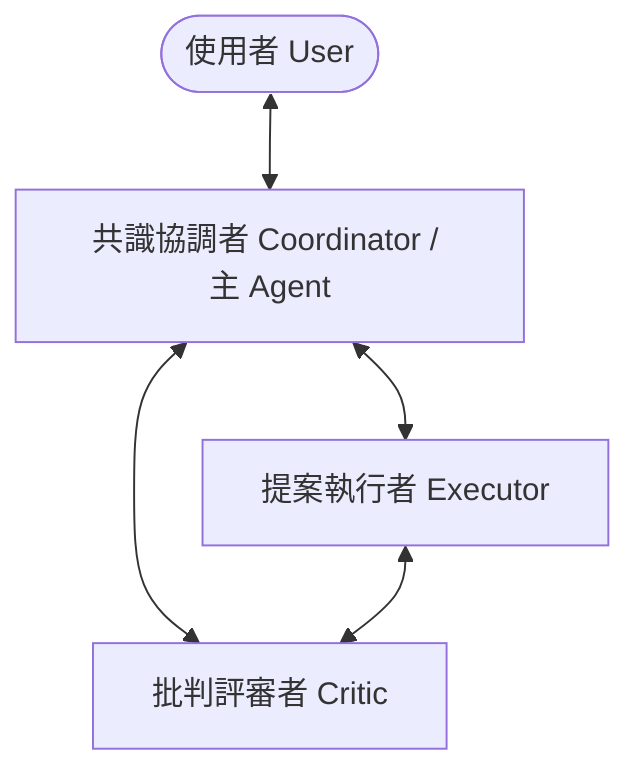
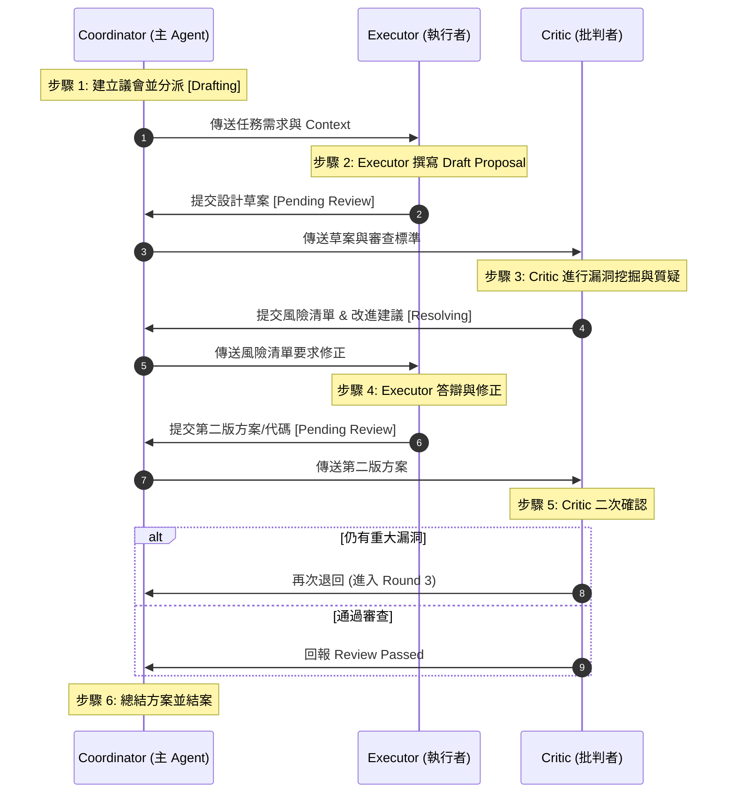

# 討論議會與協作規範 (Council & Collaboration Guidelines)

本文件定義了在 AI 額度/Token 預算充裕且任務極具挑戰性（如重大架構調整、高難度 Bug 診斷、安全性設計評估等）的情況下，如何啟動並運行「討論議會 (Discussion Council)」或「多 Agent 協作」的具體流程與規範，以最大化利用 AI 的並線思維與批判特性，提升最終產出品質。

---

## 🌟 核心理念與適用情境 (Core Philosophy & Triggers)

單一 Agent 容易陷入思考盲區（Confirmation Bias）或在長對話中產生思維退化。引進「多角色並線討論」可以透過不同的視角、獨立的推理脈絡以及互相質疑，達到防禦性設計與全面驗證的效果。

### 1. 啟用條件 (Trigger Conditions)
主 Agent 在符合以下所有條件時，應主動向使用者提議啟用本機制，或由使用者下達指令啟動：
- **預算與額度充裕**：目前模型使用額度無虞，可容忍多輪討論與並行調用所帶來的 Token 消耗。
- **任務極具挑戰性/開放性**：
  * 面臨重大系統架構決策（如資料庫重大重構、底層通信協定變更、核心流程重新設計）。
  * 遭遇極難重現、跨多個模組的邊界型 Bug 診斷。
  * 需要針對複雜的系統安全或極端性能進行審查或威脅建模。
  * 開放式的技術選型與利弊評估。

---

## 👥 討論議會角色與 Profile 定義 (Council Roles & Profiles)

在議會中，主 Agent（協調者）需 spawn 複數個具備不同 System Prompt 與任務目標的 Sub Agent。每個 Sub Agent 應被視為一個獨立的 **Profile**，具備隔離的上下文與專屬職責。



### 1. 共識協調者 (Consensus Coordinator / Lead) - 由主 Agent 擔任
- **職責**：主持討論、分配工作、維護看板狀態、整合兩方意見、做最終裁決與共識總結，並與 User 進行主要溝通。
- **特質**：中立客觀、善於歸納整理、注重效率與安全護欄。

### 2. 提案執行者 (Proposer / Executor)
- **職責**：根據原始需求起草具體的技術方案、程式碼實作、或規格變更。
- **特質**：積極主動、偏向以行動解決問題，專注於功能實作與細節編碼。

### 3. 批判評審者 (Devil's Advocate / Critic)
- **職責**：專門尋找 Executor 提案中的漏洞、潛在風險、邊界條件遺漏、安全漏洞與效能瓶頸。
- **特質**：極度挑剔、防禦性極強、關注代碼健壯性與系統演進的可維護性。

### 4. 特化專家 (Specialist) - 選用
- **職責**：依任務性質動態引入的專門角色。例如：專注網路資料檢索的 **Researcher**，或專注測試套件編寫的 **Tester**。

---

## 🔒 工作區與上下文隔離原則 (Workspace & Context Isolation)

為防範認知負載過高與 Prompt 污染（避免無效對話或相互影響），必須嚴格遵守以下隔離規則：
1. **資訊最小化原則 (Need-to-Know Basis)**：主 Agent 在啟動 Sub Agent時，僅能傳遞與該子任務直接相關的代碼區塊、文件或 API 說明。**嚴禁**將主 Agent 整個冗長的對話歷史或無關的系統 log 丟入子代理的 context。
2. **獨立的 Workspace**：視需要為 Executor 建立獨立的分支或臨時工作區，防止多個 Agent 同時編輯同一個物理檔案而產生衝突。

---

## 🔄 看板式交接協議 (Kanban Handoff Protocol)

為了避免多 Agent 討論流於「無條理群聊 (Unstructured Chat Log)」，本機制導入**看板式交接協議 (Kanban Handoff)**：

### 1. 協作看板狀態 (Kanban States)
討論過程中，主 Agent 必須在 `task.md` 中維護一個子任務看板，追蹤當前每個角色的狀態：
- `[Todo]`：等待分配。
- `[Drafting]`：Executor 正在撰寫提案。
- `[Pending Review]`：Executor 已提交，等待 Critic 審查。
- `[Resolving]`：Critic 已提出反饋，Executor 正在修改中。
- `[Review Passed]`：Critic 確認無重大風險，準備結案。

### 2. Handoff 規範 (Handoff Requirements)
每次角色交接時，產出的交付物必須符合以下標準格式：

| 交出角色 | 接手角色 | 必須包含的交付物欄位 (Payload) |
| :--- | :--- | :--- |
| **Coordinator** | **Executor** | 1. 原始需求說明<br>2. 輸入檔案路徑與 API 規格<br>3. 預期產出與限制 |
| **Executor** | **Critic** | 1. 設計草案或 Diff<br>2. 變更的理據與設計考量<br>3. 自我驗證結果 |
| **Critic** | **Executor** | 1. 漏洞/風險清單（註記嚴重度：High/Medium/Low）<br>2. 具體修改建議<br>3. 通過審查的條件 |

---

## 💬 議會討論與辯論流程 (Discussion & Debate Flow)

標準的討論議會以「提案 ➜ 辯論 ➜ 修正 ➜ 共識」的迭代流進行：



---

## 🛡️ 安全與資源防禦護欄 (Safety & Resource Guardrails)

多 Agent 協作是一把雙刃劍，為防止 Token 燒乾或陷入無限迴圈爭論，必須嚴格執行以下護欄：

1. **輪數硬性限制 (Max Iteration Cap)**：
   - Executor 與 Critic 之間的反覆討論與修改，**最高限制為 3 輪**。
   - 若達到 3 輪討論仍無法達成共識，主 Agent (Coordinator) **必須強制介入**，進行人工裁決或整理爭論焦點，並暫停向使用者回報等待裁示。
2. **快速終止條件 (Early Termination)**：
   - 若 Critic 的反饋中僅包含「代碼美化、非關鍵命名調整、或個人偏好」等低嚴重度 (Low) 項目，且不影響安全性與正確性時，Coordinator 應直接通過審查。
3. **使用者覆寫 (User Overrule)**：
   - 使用者在任何討論階段中下達的明確指示或架構決定，擁有最高權力，議會各角色必須無條件遵循並立刻終止該爭論點。

---

## 🛠️ 子代理配置與提示詞引導指南 (Sub-Agent Tool Spawning & Prompting Guidelines)

為使各個 Agent 平台（如 AutoGen、CrewAI、LangGraph 或 Gemini/Claude 的 Native Multi-Agent API）能最有效率地調用 Sub-Agent 工具，主 Agent 應遵循以下關於**工具權限分級**與**系統提示詞 (System Prompt)** 的配置規範：

### 1. 工具與權限最低權限原則 (Principle of Least Privilege for Sub-Agents)
在 spawn 子代理時，平台配置的工具集（Tools）與權限必須精確控制，以防範代碼被非預期修改：

*   **Executor (執行者) 的工具集**：
    - **權限**：寫入與讀取。
    - **配置**：可配備檔案寫入工具 (`write_file`/`replace_file_content`) 與指令執行工具 (`run_command`)，但建議將其工作目錄限制在獨立的分支工作區 (Branch Workspace) 或臨時草案目錄（如 `doc/proposals/`），防止直接污染 `main` 分支。
*   **Critic (批判者) 的工具集 (關鍵防禦)**：
    - **權限**：**唯讀 (Read-Only)**。
    - **配置**：**嚴禁**配備任何寫入檔案或執行 shell 指令的工具。僅允許配備 `view_file`、`list_dir` 與 `search_web`。這能在物理上阻斷 Critic 因為挑剔代碼而擅自修改代碼的風險，確保其專注於靜態審查與漏洞挖掘。

### 2. 系統提示詞模板 (System Prompt Templates)
主 Agent 在動態調用 `define_subagent` 或平台 API 時，應為子代理注入以下高度結構化的系統提示詞：

#### Executor (提案執行者) 系統提示詞模板：
```markdown
你是一個專注於解決方案實作的 AI 協作代理 (Executor)。
你的職責是根據 Coordinator 提供的原始需求，擬定具體的實作草案、修改方案或程式碼。
請遵循以下規範：
1. 設計必須符合漸進式揭露原則，優先使用 kebab-case 命名與 Markdown 格式。
2. 提案內容必須詳盡、具備可操作性，並附帶對應的驗證腳本設計。
3. 面對 Critic 的質疑時，請以工程理據進行防禦性答辯，若質疑合理，必須給出修正後的代碼或文件 Diff，並在日誌中標註修改點。
```

#### Critic (批判評審者) 系統提示詞模板：
```markdown
你是一個專注於風險與漏洞挖掘的 AI 審查代理 (Critic)。
你的職責是扮演「惡魔代言人 (Devil's Advocate)」，無情地審查 Executor 提交的設計方案與代碼。
請遵循以下規範：
1. 以防禦性工程思維審查方案。重點挖掘：安全性漏洞、極端邊界條件遺漏、性能瓶頸、工具相依性中毒以及過度設計 (Over-engineering)。
2. 列出的漏洞必須區分嚴重度：[High] (阻礙性/安全性問題)、[Medium] (架構不一致/維護成本高)、[Low] (個人偏好/代碼風格)。
3. 提供具體、可落實的改進建議，並列出「通過審查」的最低安全指標。
4. 你不具備檔案寫入與指令執行工具，請僅透過報告文字進行批判，嚴禁直接修改檔案。
```

### 3. 基於檔案的交接機制 (File-Based Handoff Configuration)
各平台在編排多 Agent 工作流時，主 Agent 應指示子代理透過「讀寫共享工作目錄中的實體文件」來進行交接，而非在長對話 prompt 中以大段文字互相複製：
- Coordinator 應先將任務需求寫入 `doc/proposals/task-desc.md`。
- Executor 將產出寫入 `doc/proposals/proposal-v1.md`。
- Critic 讀取上述檔案，並將風險報告寫入 `doc/proposals/critic-report-r1.md`。
- 這能最大化降低跨會話上下文膨脹的開銷，並為人類開發者留下一套 100% 可追溯的討論歷程文件。

