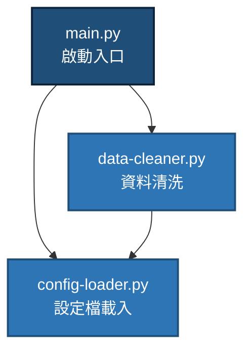

> ⚠️ **範本說明 (Template Notice)**：本檔案為專案架構藍圖之宣告範本 (`modules-template.md`)。專案創立與部署時請依據實際模組結構進行填寫與調整。

# 專案物理結構與模組地圖模板 (Modules Mapping)

本文件用以定義本專案物理檔案的組織結構、核心類別/模組的責任劃分，以及各組件之間的靜態調用依賴關係。

---

## 1. 物理檔案結構地圖 (File Layout Map)

> [說明：請在此列出專案目錄下各主要檔案的結構，方便新加入者快速了解每個檔案的物理位置]

```
[專案根目錄]/
├── plan/                     # 必要：專案管理與規範
├── doc/                      # 必要：細部規格定義
├── structure/                # 必要：架構與關係藍圖
├── README.md                 # 專案說明書
│
├── [以下為本專案啟用的參考/自訂目錄]
├── source/                   # 成品/原始碼存放區
│   ├── main.py               # 範例：應用程式啟動入口
│   ├── data-cleaner.py        # 範例：資料前處理與過濾模組
│   └── config-loader.py       # 範例：設定檔讀取模組
│
└── test/                     # 驗證/測試存放區
    ├── test-data-cleaner.py    # 範例：針對 data-cleaner.py 的單元測試
    └── test-config-loader.py   # 範例：針對 config-loader.py 的單元測試
```

---

## 2. 核心組件職責說明 (Component Responsibilities)

> [說明：詳細列出各個物理檔案中主要類別、函式或文件的具體職責]

### 🛠️ 組件一：`[例如：資料處理模組 - source/data-cleaner.py]`
- **職責**：`[負責將輸入的原始文字進行降噪、過濾，並導出符合規範的格式]`
- **核心函數/類別**：
  - `class RawDataProcessor`：封裝主處理程序。
  - `def clean_text(text: str) -> str`：移除特定符號並進行字元標準化。

### 🛠️ 組件二：`[例如：設定管理模組 - source/config-loader.py]`
- **職責**：`[負責讀取與解析 config.json，提供執行緒安全的全域配置讀取]`

---

## 3. 組件靜態依賴關係 (Static Dependencies)

> [說明：使用 Mermaid 流程圖展現各組件之間的引導與載入關係（由上至下/由外至內）]


